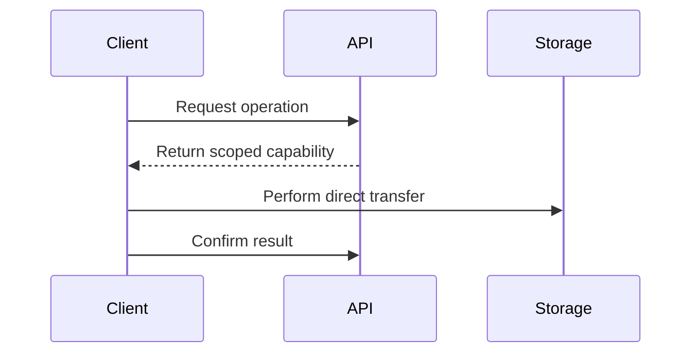
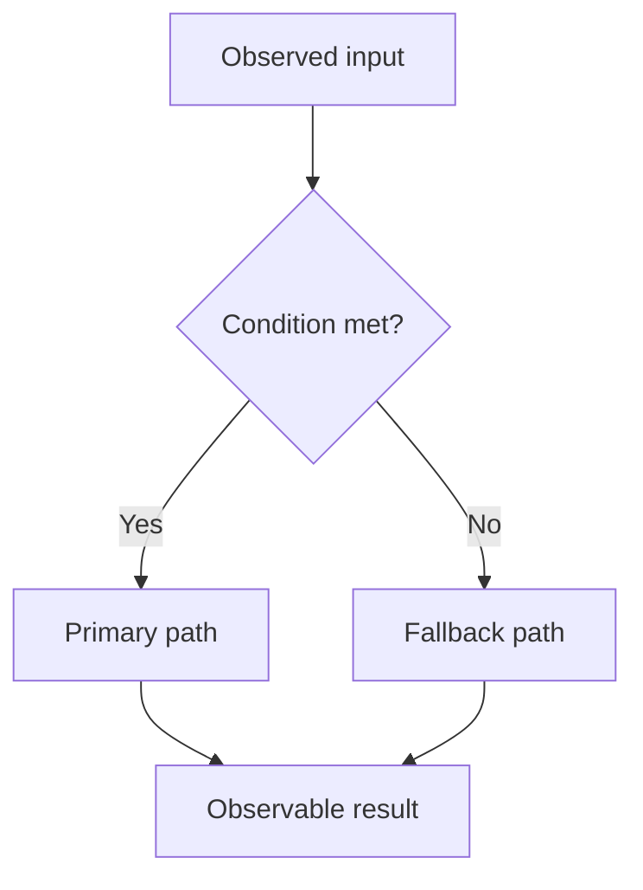
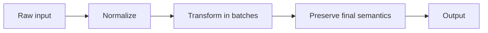
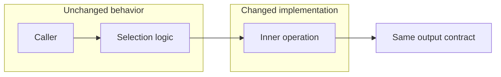
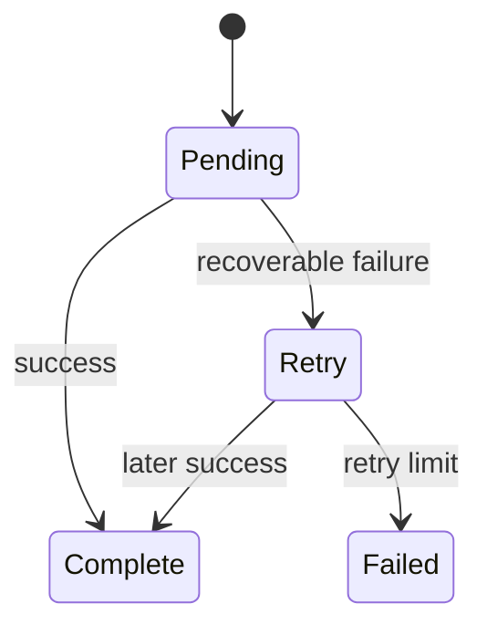

# Diagram Selection

Choose a visual by the **shape of the information**, not by domain or by a favorite template. One diagram answers one primary reader question.

## Selection table

| Information shape / reader question | Preferred form | Keep out of it |
|---|---|---|
| Nested calls: where is the relevant code reached? | Call-flow diagram | Data values and timing detail |
| Ordered interaction across components: who sends what, and when? | Sequence diagram | Internal implementation of every participant |
| Branching logic: what decisions produce each outcome? | Flowchart | A linear numbered narrative |
| Transformation or movement: how does data change through stages? | Data-flow or pipeline diagram | Unrelated ownership boundaries |
| Change boundary: what changed and what stayed stable? | Before/after or boundary view | Full source-code reproduction |
| Lifecycle: which states and transitions are valid? | State diagram | Unordered feature lists |
| Mapping: which item corresponds to which source, owner, or result? | Compact table | Dozens of parallel diagram nodes |
| Proof: how does evidence close a claim? | Verification flow plus evidence table | Unsupported conclusion text |
| Parallelism: how are elements processed in parallel (SIMD lanes, batching)? | Text-sketch (lane diagram) | Per-element narration |
| Memory / buffer layout: what occupies which region, what is reused? | Text-sketch (layout diagram) | Byte-exact address dump |
| Role / ownership along a flow: who does each step? | Text-sketch (flow with a right-column responsibility label) | A separate ownership table detached from the flow |
| All-of conditions (AND-intersection): every layer must hold | Text-sketch (funnel / ∩-chain) | Prose list of prerequisites |

If two candidate diagrams show the same path, keep the one that answers the more important question. Use a table or boundary note only for exact values or mappings; do not flatten a different process or causal question into rows merely to reduce the diagram count.

## Complexity-sensitive visual budget

Classify the source before applying a visual count:

- **Short or single-mechanism note:** use **1–3 non-duplicative core diagrams** according to distinct supported questions; one diagram is sufficient for a one-question source.
- **Long or multi-stage handoff:** let independent reader questions determine the count; **4–7 diagrams is a common range, not a quota**. Keep up to 2–3 core visuals in the one-minute path and move the remaining mechanism, attribution, proof, or decision visuals into deep review.

A long source deserves another diagram when it adds a distinct supported layer such as transformation stages, before/after execution shape, resource causality, performance attribution, experiment isolation, or validation closure. It does not deserve another diagram when the candidate only redraws the same arrows with different decoration.

For process-heavy technical handoffs, diagrams should normally be at least as numerous as tables. This is a diagnostic, not a scoring rule: pure specifications or lookup-heavy references may correctly use more tables.

## Visual-encoding decision (two steps)

**Step 1 — diagram or table?** Use a **diagram** when understanding depends on order, causality, branching, state, transformation, layout, parallelism, boundaries, or proof closure. Use a **table** only when the reader compares exact parallel values, fixed properties, file/owner mappings, or compact evidence references. A diagram may point to an exact-value table; the table must not narrate the diagram in row form. Do not pick a table just to stay under a diagram count—choose by information shape, then remove only duplicate visuals. A table that actually encodes a flow, causal chain, layout, or parallelism is a signal to convert it to a diagram.

**Step 2 — Mermaid or text-sketch?** Both are canonical.

- **Mermaid** for flow / sequence / state / architecture graphs that benefit from rendering and have several branches or participants.
- **Text-sketch** (fenced plaintext ASCII) when the point needs precise inline annotation a rendered box cannot hold cleanly (a right-hand "who / effect" column, exact conditions), or is a parallel-lane / SIMD layout, memory/buffer layout, AND-intersection funnel, or a compact state machine—or when platform rendering is unreliable and copy-pasteable monospace is preferable.

When the same chain would appear in both an overview / 定位 section and a detailed section, the two must answer **different** reader questions (e.g. ownership / 责任分工 vs data-flow-with-fallback); otherwise keep one.

## Construction rules

- Give one mechanism or causal chain one primary visual. If a sequence diagram already shows that chain, use a table for its exact timings or evidence; use another diagram only for a different question such as failure lifecycle or experiment validity.
- Preserve evidence-backed intermediate states. A start→end summary fails when the omitted transformation or causal steps are necessary to support the conclusion.
- Aim for **5–9 semantic nodes** in core diagrams. A deep-review diagram may use up to about **12** when the nodes form one coherent question; otherwise split by phase or question.
- Define specialized terms before the first diagram that uses them; label nodes in plain language first, with exact source labels in parentheses when needed.
- Use subgraphs only for real component, phase, trust, experiment, or change boundaries.
- Add a legend whenever color, line style, symbol, or abbreviation carries meaning. Never rely on color alone; labels must still work in grayscale.
- Add at most one takeaway after a diagram when it contributes a boundary, exception, or decision. Omit it when the labels already carry the point.
- **No vague, guessed, or unverified label.** A condition, threshold, gate, or step in a visual must be precise and evidence-backed, or marked unknown. Do not invent a plausible-sounding gate to fill a branch (e.g. write "compile-time flag on?" only if the source establishes it; never a filler "size ok?"). A wrong-but-tidy diagram is worse than honest prose.

## Compact Mermaid patterns

These are generic patterns to adapt, not fixed document templates.

### Call flow — position in the system


### Sequence — cross-component interaction



If dashed and solid arrows have special meanings beyond Mermaid convention, add an adjacent legend such as `solid = request; dashed = response`.

### Decision flow — causal or branching behavior



### Data flow — transformation stages



### Change boundary — changed versus unchanged



### State model — lifecycle



## Markdown text-sketch (ASCII) patterns

A text-sketch is a fenced `plaintext` code block drawn with box/arrow characters (`─ │ ┌ ┐ └ ┘ ▼ ► ◄ ⇄ ∩`). It renders as monospace everywhere, needs no image round-trip, and can carry exact inline annotations that Mermaid boxes cannot hold cleanly.

When to reach for it vs Mermaid: see the two-step encoding decision above (text-sketch for precise inline annotation, lanes/layout/funnel/compact state machine, or unreliable rendering; Mermaid for many-branch rendered graphs).

**Construction rules**: keep total width modest (it must not overflow the text column); annotate a right-hand column for "who owns it" or "the effect"; one idea per block; CJK characters are double-width, so prioritize readability over pixel-perfect alignment; follow with at most one takeaway.

### Pipeline / data-flow with a responsibility column

```plaintext
输入 ─► 阶段A ─────────────────────────►  (谁管/效果)
          │
          ▼
        阶段B ─────────────────────────►  (谁管/效果)
```

### Parallel lanes — scalar vs SIMD

```plaintext
标量 (1 个/拍):  acc += a0·k0 → a1·k1 → ... → aN·kN
SIMD (N 个/拍):  [a0 a1 a2 a3]         lane0..3
                 [k0 k1 k2 k3]  ┐ 一条指令 = N 个乘加
          acc4 += [.. .. .. ..] ┘  收尾: 横向求和
```

### AND-intersection — every layer must hold

```plaintext
① 条件A   ─┐
② 条件B    ├─ 全部满足 ─► 目标成立
③ 条件C   ─┘   任一不满足 ─► 退回/失败   ← 只有"最终实测层"算数
```

### Memory / buffer layout and reuse

```plaintext
arena: [ ... | scratch(中间) | ... ]
                  │ 用完释放
                  ▼
       [ ... | 输出 buffer   | ... ]   ← 复用同一区段
```

### Compact state machine (hysteresis)

```plaintext
   ┌─────────┐  进入阈值   ┌───────────┐  持续够久 → 记录 start   ┌────────┐
   │ 静音    │ ──────────►│ 疑似语音   │ ───────────────────────►│ 语音   │
   └─────────┘ ◄────────── └───────────┘ ◄─── 恢复 ───────────── └────────┘
        ▲  时长不足回退                         退出阈值 │
        └──── 静音够久 → 记录 end ◄─────────────────────┘
```

Each node/edge/label is still copied from evidence or marked interpretation; a text-sketch does not license invented steps.

## Explicit case study: LC3 SIMD review — not a universal template

For one LC3 optimization review, two distinct questions justified two diagrams:

1. A call-flow located the changed dot product beneath the encoder and lag search.
2. A data-flow explained that four **sample pairs within one lag** were processed together while lag candidates remained serial.

That pairing is specific to the evidence shape. Do not copy it into incidents, feature handoffs, or decisions that require sequence, state, causal, or comparison views. In the LC3 case, exact labels such as `pa`, `pb`, and HiFi4 intrinsics belong after their plain-language meanings, and numerical equivalence must be tied to the unchanged accumulator and rounding path rather than implied by visual similarity.
